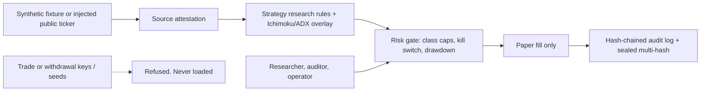

# Security architecture (v0.44)

Version 0.44 extends the control plane with sealed lineage and expanded secret detection. Still a research design, not a certified security product and not legal advice.

## Trust boundaries

The system has no order router. `assert_paper_only` refuses any mode other than `PAPER`. Roles cannot enable live trading.

## Roles

| Role | Allowed | Denied |
|---|---|---|
| Researcher | scan, backtest, read audit | place order, withdraw, enable live |
| Auditor | read audit, verify chain, scan | place order, withdraw, enable live |
| Operator | scan, kill switch, read audit | place order, withdraw, enable live |

There is no trader role. Promoting a signal to a broker is a separate system.

## Data classes

| Field | Class | Handling |
|---|---|---|
| Symbol, OHLCV | Public market | Synthetic in this repo |
| Funding rate | Public market | Research feature only |
| Source label | Integrity | Must be SYNTHETIC or PUBLIC_READ |
| Seed phrase / private key | Secret | Refused and redacted |
| Wallet address | Sensitive identifier | Redacted, banned from fixtures |
| Email, NRIC, phone | Personal | Tripwire |

## Threats and controls

| Threat | Control |
|---|---|
| Secret committed | gitleaks CI, expanded redaction, no key loader |
| Trade key or seed pasted | Expanded patterns + refuse |
| Strategy injection via fixture | SYNTHETIC label required, source attestation |
| Oversized risk on weak trends | ADX and Ichimoku filters + class caps |
| Audit tamper | SHA-256 chain + sealed multi-hash + timestamps |
| Live-order mistake | No live client; mode guard; RBAC deny |

## Incident handling

1. Engage the kill switch. New paper size goes to zero.
2. Freeze the audit chain and record the source attestation digest and sealed hash.
3. If a secret was pasted, rotate it outside this repo and purge it from history.
4. Do not open a public issue that contains a secret or a wallet address.
5. A human reviews before the kill switch is cleared.

## Operating rules

- Market-data credentials, if ever added, stay read-only and separate from any future trade credential.
- Logs pass through `redact` before they are stored.
- Default deployment is research. Promoting a signal to a broker is a separate, human-approved system.
